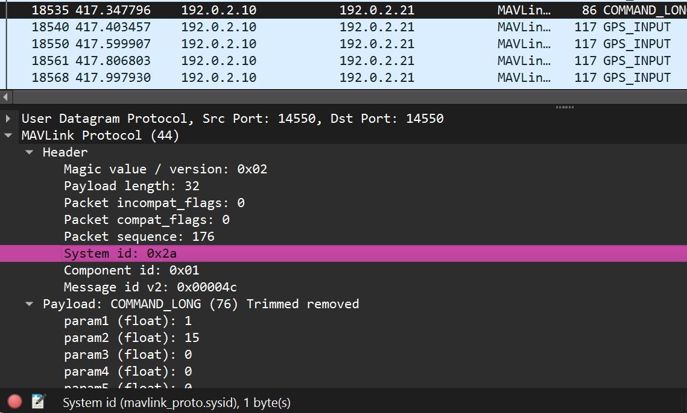
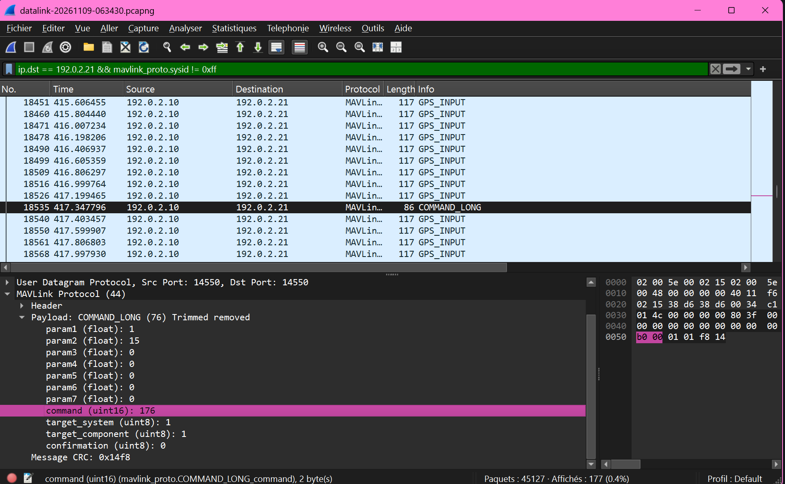
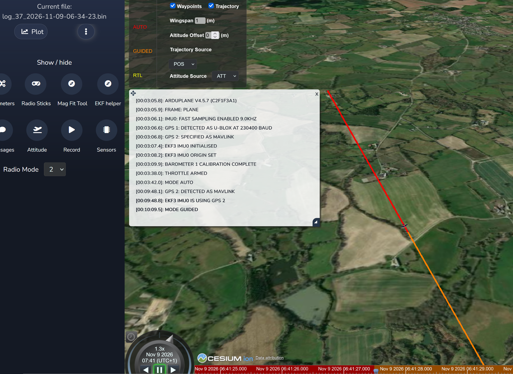
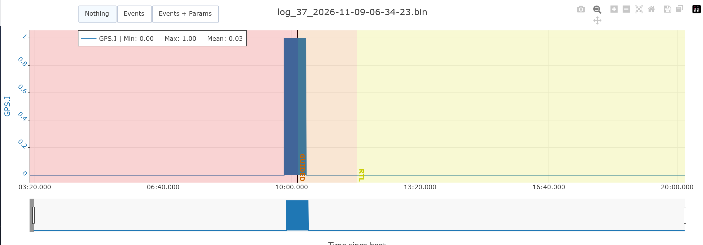
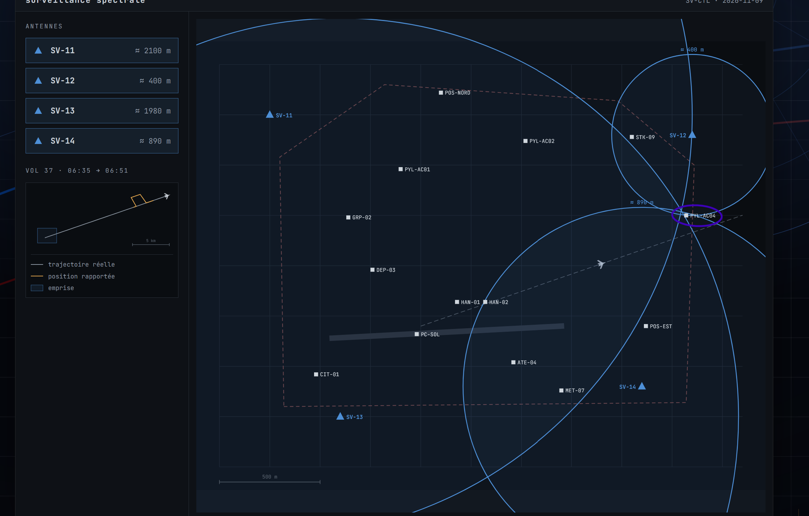
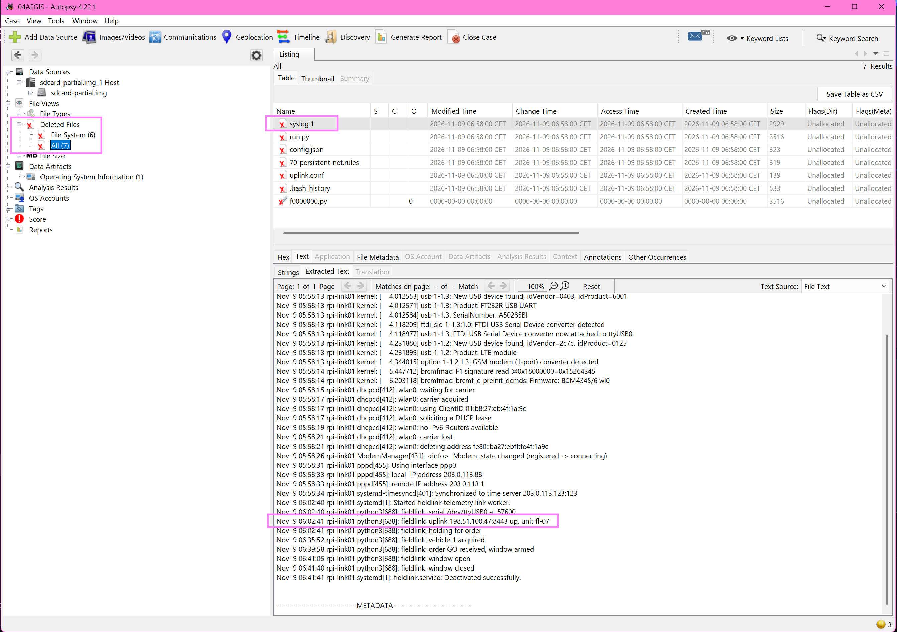
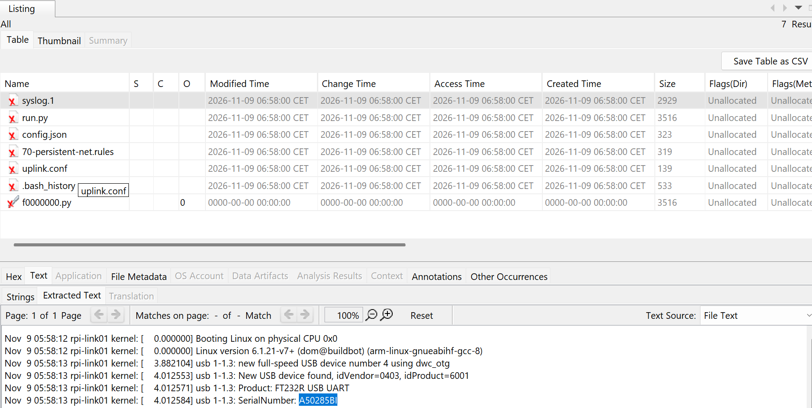

# Opération AEGIS

# 1 Capture du lien
(réseau)
Pour ce challenge j'ai tourné pendant un bon moment car je ne savais pas qu'il fallait installer le plugin LUA sur wireshark (dont le pourquoi que je ne voyais que des paquets UDP )
https://gist.github.com/dagar/c006ce6014fd56fbdab92af062bd8e19#file-mavlink_common-lua

Le paquet qu'on cherche est un paquet avec une commande donnée au drône donc un paquet MAV_LINK de type COMMAND

Par défaut, Wireshark ne décode pas le protocole MAVLink au-dessus d'UDP. Pour analyser les trames, j'ai donc ajouté la librairie dans l'outil.

En inspectant les conversations réseau (Statistiques > Conversations > UDP) et les en-têtes MAVLink Protocol, on observe un seul flux IP/UDP sur le port 14550, mais plusieurs identifiants système (System ID) distincts partageant le même canal radio :
• Drone cible : IP 192.0.2.21 — System ID: 0x01 (1)
• Station sol légitime (GCS) : IP 192.0.2.10 — System ID: 0xff (255)

Donc on va appliquer un filtre de recherche pour isoler les paquets reçus par le drone qui ne proviennent pas de la station sol légitime (0xff) :
**ip.dst == 192.0.2.21 && mavlink_proto.sysid != 0xff**

Ce filtre fait ressortir un émetteur inconnu identifié par System ID: 0x2a, responsable de 2 actions malveillantes :

1. GPS Spoofing : Injection de messages GPS_INPUT, expliquant le saut soudain de coordonnées rapporté par le drone.

   
2. Détournement du plan de vol (Frame 18535) : Envoi d'un paquet COMMAND_LONG (ID 76) ciblant le drone (target_system: 1, target_component: 1).

Détail du paquet malveillant (Frame 18535)

• Message MAVLink : COMMAND_LONG (76)
• Commande (command) : 176 → MAV_CMD_DO_SET_MODE
• Paramètres :
	• param1 = 1 (MAV_MODE_FLAG_CUSTOM_MODE_ENABLED : activation du mode personnalisé)
	• param2 = 15 (Mode GUIDED sous ArduPilot)
En forçant le passage en mode GUIDED, l'attaquant a fait quitter au drone son mode automatique (AUTO), provoquant l'abandon immédiat de son plan de vol.

Commande MAVLink : **MAV_CMD_DO_SET_MODE**

Heure de la frame : **UTC Arrival Time: Nov  9, 2026 06:41:27.350000000 UTC**

`RM{2026-11-09T06:41:27Z:MAV_CMD_DO_SET_MODE}`

# 2 Investigation
(forensic)

Pour cela il fallait se rendre sur le site [], et charger le fichier bin, 
Ensuite activer l'option Messages puis avancer à l'heure qu'on a extrait précédemment (selon la map : 06:41:27:500).

Comme on peut le voir à ce moment là le drône passe du mode AUTO au mode GUIDED, et juste avant (00:09:48:100) le drôle détecte le second GPS 2 qui va la détourner de sa trajectoire initiale.

Et sur le message l'horloge est à 00:10:09:50.

On va donc calculer le décalage entre l'horloge interne et l'UTC :

06:41:27:500 (UTC) - 00:10:09:500 = 06:31:18:000

On applique maintenant le décalage de 06:31:18:000 au message où le GPS 2 est détecté :

06:31:18:000 + 00:09:48:100 = 06:41:06.100

On voit bien que c'est GPS1 

`RM{2026-11-09T06:41:06Z:GPS1}`

# 3 Localisation de la source
(radio fréquence)

Cet étape était très rapide, il fallait activer toutes les antennes puis localiser l'installation la plus proche du point d'intersection, qui est PYL-AC04.

`RM{PYL-AC04}`

# 4 Matériel abandonné
(reverse engineering)

Pour trouver ces données, j'ai ouvert l'extrait de l'image mémoire du boitier dans Autopsy, et je suis partie dans les fichiers supprimés et dans les logs du systèmes (syslog.1)

On trouve par la suite une connexion uplink avant que le service soit désactivé.

`RM{198.51.100.47:8443}`

# 5 Attribution
(forensic)

Il y avait plusieurs moyens de trouver le boitier dans le CSV grâce à l'image du boitier, pour ma part j'ai prit par rapport au numéro de série : **A50285BI**

Et en cherchant dans le fichier CSV on trouve la ligne qui correspondant à ce numéro de série.

`RM{2026-10-26:bruno_tessier}`

# 6 Rejeu de la vulnérabilité
(pentest)

Pour celui-là je n'ai pas pu le terminer au moment où j'écris ce writeup, mais j'ai pu le commencer. 

J'ai d'abord télécharger MAVPROXY pour pouvoir l'utiliser pour la communication en MAVLINK.

Sur un terminal je vais me connecter au banc d'essaie :
nc sandbox.armee-air-espace.challenges.root-me.pro 5760

et sur un autre terminal, je vais me connecter avec MAVPROXY, et surtout partie là il faudra passer en mode GUIDED, donc en faisant mode GUIDED.

puis ensuite je n'ai pas pu avancer +..