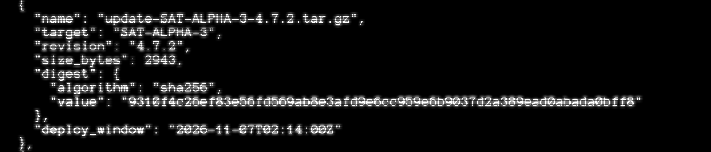
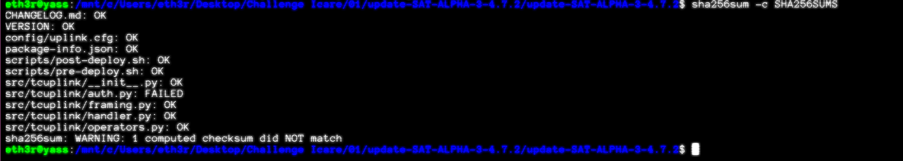
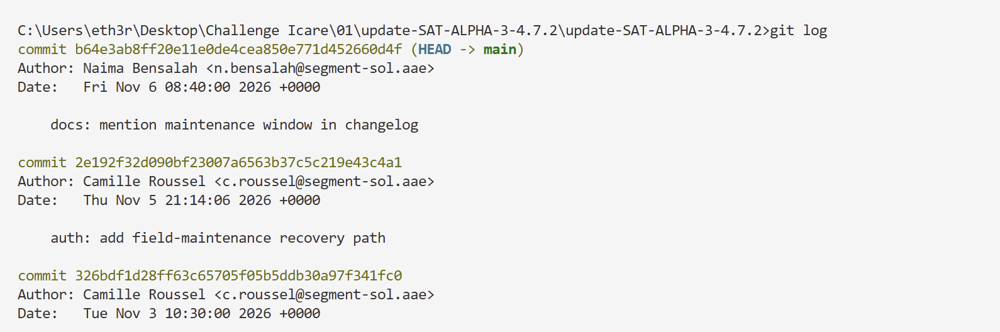
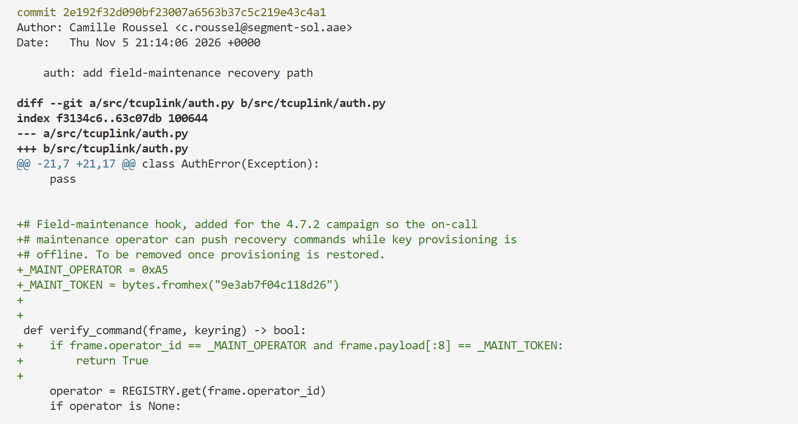
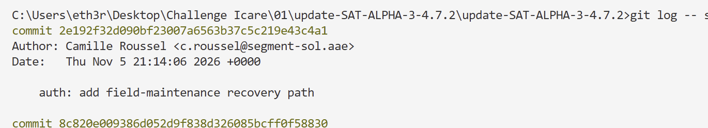
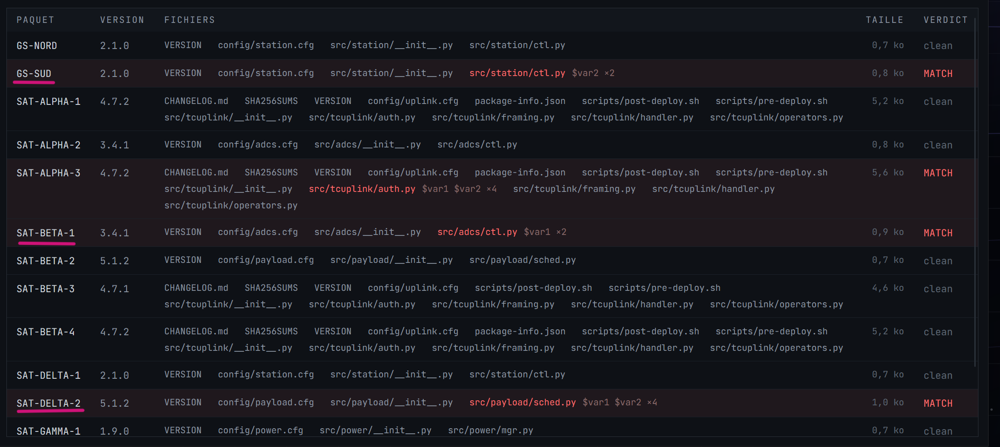
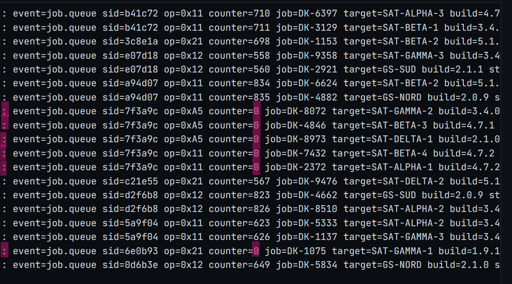
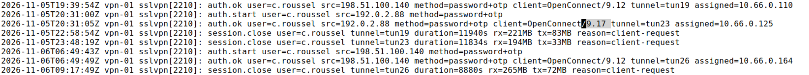

# Opération ICare

## 1. Contrôle d'intégrité (facile)
(cryptographie) 
Pour cette première tache de Cryptographie 
Il y a eu un transfert défectueux d'un paquet dû à sa signature, notre objectif est donc de recalculer l'empreinte du paquet et de comparer à celle qu'annonce le manifeste. 

Etant donné que je n'avais jamais fait de challz de cryptographie auparavant j'ai dû me renseigner sur Internet  pour mieux comprendre la notion d'intégrité en cryptographie et revoir la notion de hashage.

Comme on peut le voir dans notre manifeste, l'algorithme de hashage utilisé est le **SHA-256**. 

Donc pour calculer l'empreinte de l'archive la commande sera : sha256sum paquet.

La réponse retournée est : `65609e9a9e7710b8c1a1a9b2d56d7df2f3964eadf67edb2333103298c0e3eccf`

La chaîne du manifeste du paquet : `9310f4c26ef83e56fd569ab8e3afd9e6cc959e6b9037d2a389ead0abada0bff8`

On peut voir donc que c'es totalement différent d'oû l'échec de la verification de signature.

`RM{65609e9a9e7710b8c1a1a9b2d56d7df2f3964eadf67edb2333103298c0e3eccf}`

## 2. Analyse de paquet 
(reverse engineering)
Pour ce challenge là il faut analyse le paquet en question afin d'identifier le paquet modifié avec son chemin, puis relever les 2 valeurs écrites en dur dans le code ajouté, l'identifiant numérique d'opérateur en hexadécimal et le jeton.

On voit que c'est le fichier auth.py qui a été modifié.
aa0bd6a8da28e556231e130e0aed8ac71f15d00ca17a93d42666139552d8c82f  src/tcuplink/auth.py

Et on trouve dans ce fichier python : 
_MAINT_OPERATOR = 0xA5
MAINT_TOKEN = bytes.fromhex("9e3ab7f04c118d26")

Donc le flag est : **RM{src/tcuplink/auth.py:0xA5:9e3ab7f04c118d26}**

## 3. Remontée à la source 
(devops)

https://git-scm.com/book/en/v2/Git-Basics-Viewing-the-Commit-History

Il suffit simplement de faire la commande git log dans le terminal au chemin du paquet (personnellement j'avais initalement ouvert le dossier du paquet dans visual studio code)

Et on trouve l'email de 2 personnes Naima Bensalah et Camille Roussel :
- n.bensalah@segment-sol.aae
- c.roussel@segment-sol.aae
Etant donné que le dernier commit revient à celui de Naima Bensalah c'est donc elle qui s'est introduite.

Mais ma commande n'étant pas assez précise j'ai rajouté l'option -p (ou --patch) qui montre la difference introduite dans chaque commits

Et finalement en faisant cette commande je trouve que c'était Camille Roussel qui avait introduit les lignes.

Mais en cherchant sur les sites, je me suis dis que je pouvais simplement axé encore + ma recherche de log en spécifiant direment le fichier auth.py donc en faisant : 

`git log -- src/tcuplink/auth.py`

et en faisant cette commande on retrouve directement le commit qu'on cherche : 

Et c'est bien le commit **2e192f32d090bf23007a6563b37c5c219e43c4a1**

`RM{2e192f32d090bf23007a6563b37c5c219e43c4a1:c.roussel@segment-sol.aae}`

## 4. Identifiaction d'IOC
(threat hunting)
Pour cet exercice là je n'ai jamais utilisé l'outil YAR donc je me suis aider de Gemini et de site comme [GeeksForGeeks](https://www.geeksforgeeks.org/ethical-hacking/threat-hunting-using-yara/) afin de comprendre comment mettre en places les rules, conditions et paramètres (strings) pour rechercher les paquets présentant les anomalies.

Tout d'abord je met le plus instinctif, l'email du compte compromis. 

``yara
rule search_email_camille
{
    strings:
        $email = "c.roussel@segment-sol.aae"
    condition:
        $email
}
``

Sauf que je ne vais pas trouver car YARA analyse des fichiers ou de la mémoire XD

Donc je vais opter pour d'autres conditions...
ON doit trouver les lots porteurs de l'implant, l'amplant de notre paquet actuel est : 

``
_MAINT_OPERATOR = 0xA5
_MAINT_TOKEN = bytes.fromhex("9e3ab7f04c118d26")
if frame.operator_id == _MAINT_OPERATOR and frame.payload[:8] == _MAINT_TOKEN:  return True
``

Donc pour tester je fais : 

``yara
rule search_emplant
{
    strings:
        $var1 = "9e3ab7f04c118d26"
        $var2 = "0xA5"
    condition:
        any of them
}
``

Et je trouve le paquet que nous avions de base, donc il faudra modeler les paramètres pour trouver les autres.

J'ai donc fait : 

``yara
rule search_emplant
{
    strings:
        $var1 = "_MAINT_OPERATOR"
        $var2 = "_MAINT_TOKEN"
    condition:
        any of them
}
``

Et j'ai trouvé les 3 paquets supplémentaires :
- GS-SUD 2.1.0 : src/station/ctl.py
- SAT-BETA-1 3.4.1 : src/adcs/ctl.py
- SAT-DELTA-2 5.1.2 : src/payload/sched.py

`RM{GS-SUD:SAT-ALPHA-3:SAT-BETA-1:SAT-DELTA-2}`

## 5. Confinement 
(lid)

Dans le journal d'audit, chaque action légitime de l'orchestrateur incrémente un compteur séquentiel (`counter=823`, `824`, etc.). En analysant les logs, on remarque que plusieurs tâches ont été mises en file avec `counter=0`.

Cette valeur à zéro montre que ces tâches n'ont pas suivi le flux normal de l'application (qui aurait incrémenté le compteur), mais qu'elles ont été injectées directement dans la file par l'attaquant. Il suffit donc de filtrer sur `counter=0` pour isoler et bloquer l'ensemble des jobs malveillants.
Donc ct ceux avec counter=0

- DK-8072 (sid=7f3a9c, op=0xA5, counter=0)
- DK-4846 (sid=7f3a9c, op=0xA5, counter=0)
- DK-8973 (sid=7f3a9c, op=0xA5, counter=0)
- DK-7432 (sid=7f3a9c, op=0x11, counter=0)
- DK-2372 (sid=7f3a9c, op=0x11, counter=0)
- DK-1075 (sid=6e0b93, op=0x21, counter=0, build=1.9

`RM{0301aeef7e2231e9a88be73a5dd34ffae8daaf9a}`

## 6. Attribution
(forensic)
Le flag porte l'heure UTC de la connexion VPN frauduleuse, telle qu'elle figure dans le journal du concentrateur, puis l'adresse de l'expéditeur du message d'hameçonnage qui l'a précédée.

`RM{AAAA-MM-JJThh:mm:ssZ:expediteur}`

2026-11-05T20:31:05Z vpn-01 sslvpn[2210]: auth.ok user=c.roussel src=192.0.2.88 method=password+otp client=OpenConnect/9.17 tunnel=tun23 assigned=10.66.0.125

``
From it-support@segrnent-sol.aae Thu Nov 05 20:09:44 2026
From: IT Support <it-support@segrnent-sol.aae>
To: c.roussel@segment-sol.aae
Subject: ACTION REQUIRED: VPN certificate renewal before 21:00 UTC
Date: Thu, 05 Nov 2026 20:09:44 +0000
Message-ID: <1793909384.5378666@segrnent-sol.aae>
Received: from mx.segrnent-sol.aae (unknown [203.0.113.41]) ([10.20.1.9]) by
 mail-01.segment-sol.aae with ESMTPS; Thu, 05 Nov 2026 20:09:48 +0000
Authentication-Results: mail-01.segment-sol.aae; spf=fail
 smtp.mailfrom=segrnent-sol.aae; dkim=none header.d=segrnent-sol.aae
X-Mailer: -
Reply-To: it-support@segrnent-sol.aae
X-Priority: 1
Content-Type: text/plain; charset="utf-8"
Content-Transfer-Encoding: quoted-printable
MIME-Version: 1.0
Dear user,
Following the migration of the remote-access gateway, your VPN client certifi=
cate must be
re-issued tonight. Accounts not renewed before 21:00 UTC will be locked until=
 Monday.
Renew now (2 minutes, same credentials + OTP):
    https://vpn-01.segrnent-sol.aae/renew?u=3Dc.roussel&t=3D9f3a
-- IT Support
``

`RM{2026-11-05T20:31:05Z:it-support@segrnent-sol.aae}`

# Conclusion 

J'ai beaucoup apprécié ce challenge en tant que novice, ça faisait plusieurs mois que je n'avais pas fait de ctf et cette occasion m'a permis de retrouver le goût de curisité et d'investigation que procurent les CTF :)